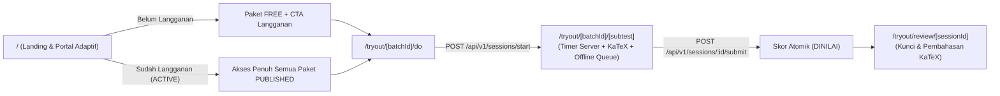
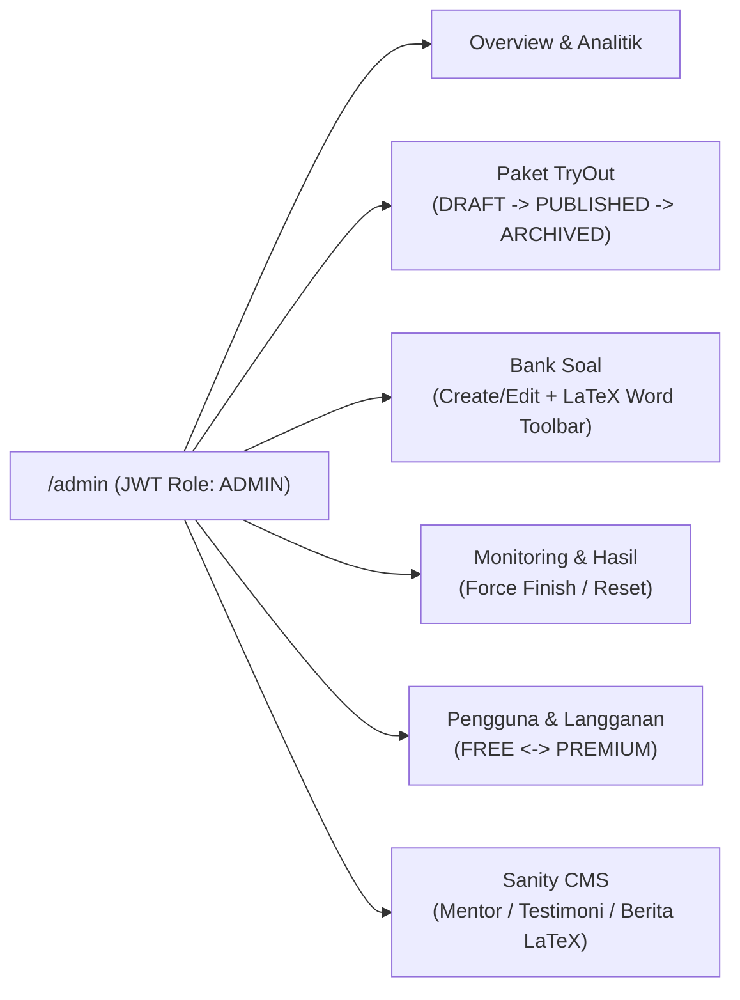

# Website Scholarify — Full TypeScript Platform

Platform terpadu **Scholarify** (`https://scholarify.id`) yang menggabungkan **Landing Page**, **Portal TryOut UTBK-SNBT CBT**, **Subscription Gating**, **Sanity CMS**, dan **CRM Admin Dashboard 6 Tab** dalam satu arsitektur **Full TypeScript**.

## Tech Stack
- **Frontend & API:** Next.js 16 (Webpack) + React 19 + TypeScript + Tailwind CSS v4 + `shadcn/ui`
- **Animasi & Smooth Scroll:** `gsap` + `motion` + `lenis` (vertical root scroll & horizontal team track)
- **Matematika / LaTeX:** `katex` (editor toolbar ala MS Word di CRM Admin + rendering aman di CBT, pembahasan, dan berita)
- **Database & ORM:** Prisma ORM (`schema.prisma` — SQLite `dev.db` lokal / PostgreSQL untuk production skala penuh)
- **Keamanan & Validasi:** JWT (`jose`) via HttpOnly cookie & Bearer header + `bcryptjs` + Zod + Security Headers (`next.config.js`)
- **CMS:** Sanity CMS (`gbwew0c6` / `production`) untuk Mentor, Testimoni, dan Berita
- **Testing & CI/CD:** Vitest (`contractSmoke.test.ts`), `tsc --noEmit`, Vercel (`frontend/vercel.json`), GitHub Actions (`.github/workflows/ci.yml`)
- **PWA:** `public/manifest.webmanifest`, `public/theme-init.js`, `public/sw.js` (**Network-Only** untuk `/api/*`)

---

## Topologi Sistem

### 1. Alur Siswa / Umum (Belum Langganan vs Sudah Langganan)


### 2. Alur CRM Admin Dashboard (`/admin`)


---

## Cara Menjalankan Secara Lokal

```powershell
cd frontend
npm install
npx prisma generate
npx prisma db push
.\node_modules\.bin\tsx.cmd prisma/seed.ts
npm run dev
```

Akses di browser:
- **Beranda / Landing Page:** `http://localhost:3000/`
- **Login:** `http://localhost:3000/login`
- **Portal TryOut:** `http://localhost:3000/tryout`
- **Admin CRM Dashboard:** `http://localhost:3000/admin`

**Akun Demo (`frontend/prisma/seed.ts`):**
- **Admin:** `admin_scholarify` / `Scholarifysuskesbarokah313`
- **Siswa Gratis:** `siswa_free` / `siswa123`
- **Siswa Premium:** `siswa_premium` / `siswa123`

*Seed data lengkap mencakup 13 user, 7 subtes UTBK (`PU`, `PPU`, `PBM`, `PK`, `LBI`, `LBE`, `PM`), 7 paket tryout, 295 soal dengan pembahasan, 18 sesi ujian, dan 15 hasil nilai.*

## Verifikasi & Build
```powershell
cd frontend
.\node_modules\.bin\tsc.cmd --noEmit
npm test
npm run build
```

---

## Struktur Direktori
```text
Website Scholarify/
├── .github/workflows/ci.yml   # Pipeline CI frontend
├── PRD.md                     # Product Requirements Document
├── README.md                  # Dokumentasi utama proyek
└── frontend/                  # Aplikasi Full TypeScript (Next.js + Prisma + Vercel Root)
    ├── app/                   # Halaman App Router & API /api/v1/*
    ├── components/            # Komponen shadcn/ui & login-form
    ├── prisma/                # schema.prisma, dev.db, seed.ts, seed-bank-soal.ts
    ├── public/                # Studio portraits (14 anggota), IG model cutouts, PWA assets
    └── src/                   # api/, components/ (landing/admin/exam/common), server/, types/, utils/
```
