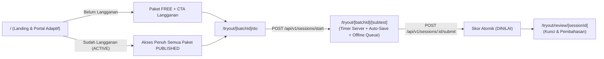
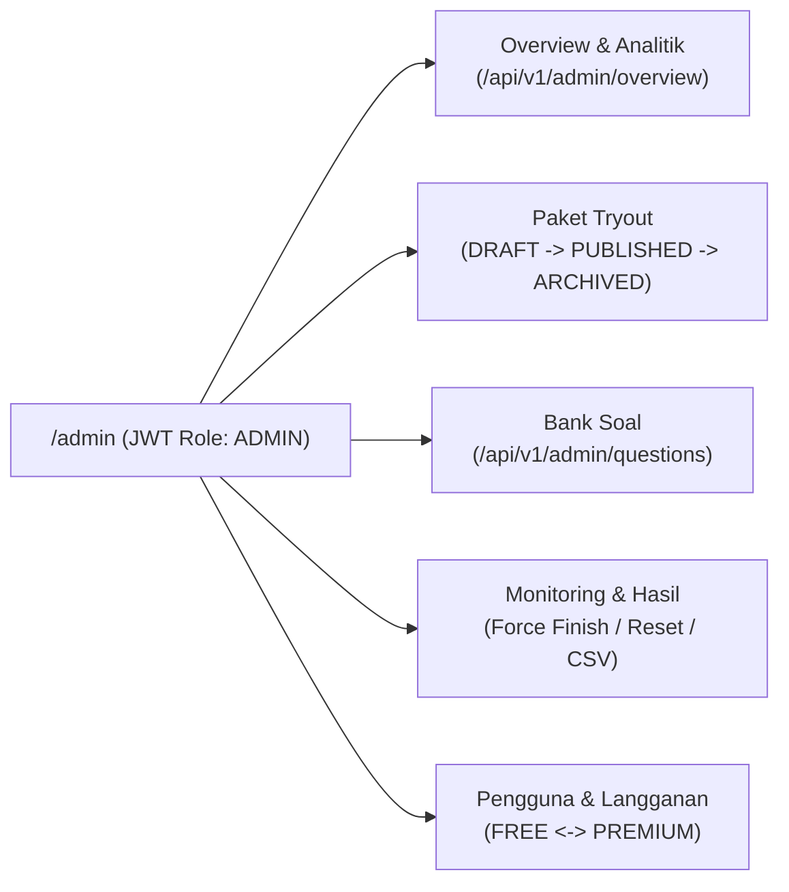

# Website Scholarify — Full TypeScript Platform

Platform terpadu **Scholarify** yang menggabungkan **Landing Page**, **Portal TryOut UTBK CBT**, **Subscription Gating** (tampilan & akses berbeda untuk pengguna sudah langganan vs belum langganan), dan **Admin Dashboard 5 Tab** dalam satu arsitektur **Full TypeScript**.

## Tech Stack
- **Frontend & API:** Next.js 16 + React 19 + TypeScript + Tailwind CSS v4 + `shadcn/ui` (`dashboard-01`)
- **Database & ORM:** Prisma ORM (SQLite untuk dev lokal, PostgreSQL untuk production)
- **Keamanan & Validasi:** JWT (`jose`) via HttpOnly cookie & Bearer header + `bcryptjs` + Zod
- **Testing & CI:** Vitest (`contractSmoke.test.ts`), `tsc --noEmit`, GitHub Actions (`.github/workflows/ci.yml`)
- **PWA:** `public/manifest.webmanifest`, `public/theme-init.js` (*anti-flash*), `public/sw.js` (**Network-Only** untuk `/api/*`)

---

## Topologi Sistem

### 1. Alur Siswa / Umum (Belum Langganan vs Sudah Langganan)


### 2. Alur Admin Dashboard (`/admin`)


---

## Cara Menjalankan Secara Lokal

```powershell
cd frontend
npm install --legacy-peer-deps
npx prisma generate
npx prisma db push
npx tsx prisma/seed.ts
npm run dev
```

Akses di browser:
- **Beranda / Landing Page:** `http://localhost:3000/`
- **Login:** `http://localhost:3000/login`
- **Portal TryOut:** `http://localhost:3000/tryout`
- **Admin Dashboard:** `http://localhost:3000/admin`

**Akun Demo (`prisma/seed.ts`):**
- **Admin:** `admin` / `admin123`
- **Siswa Gratis (Belum Langganan):** `siswa_free` / `siswa123`
- **Siswa Premium (Sudah Langganan):** `siswa_premium` / `siswa123`

## Verifikasi & Testing
```powershell
cd frontend
npx tsc --noEmit
npm test
npm run build
```

---

## Struktur Folder Lain di Repository
- `backend/` — Arsip backend Django lama (datanya sudah dimigrasikan lewat `prisma/seed.ts`).
- `landing-page/` — Arsip landing page statis lama + Sanity.
- `scholarify-admin/` — Aplikasi Laravel terpisah (tidak disentuh).
- [PRD.md](file:///c:/Users/ThinkPad/Documents/PROJECT/Website%20Scholarify/PRD.md) — Product Requirements Document lengkap.
